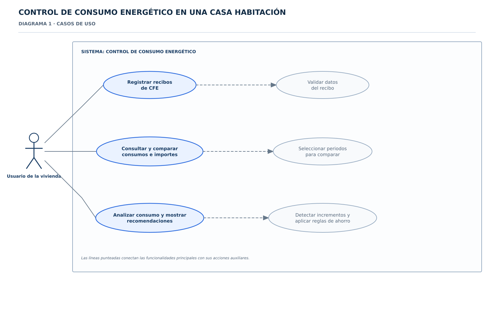
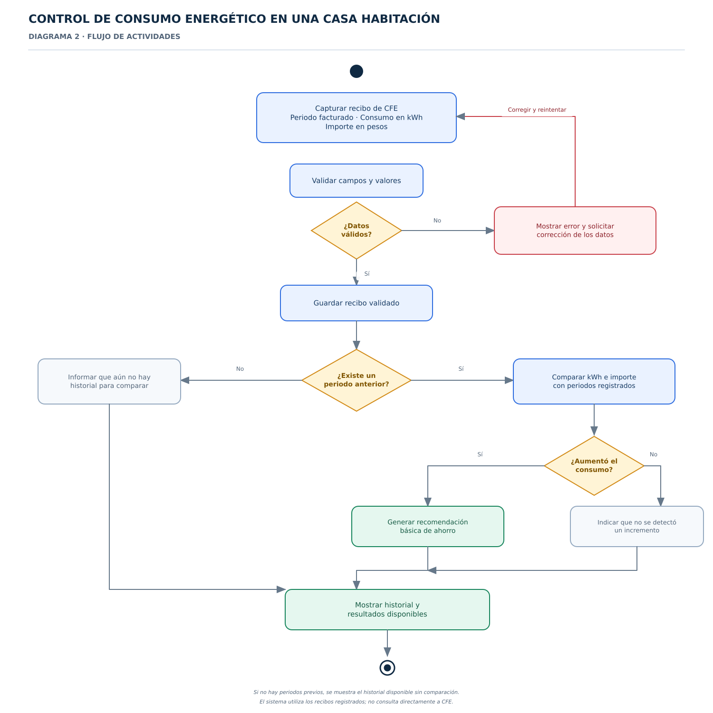
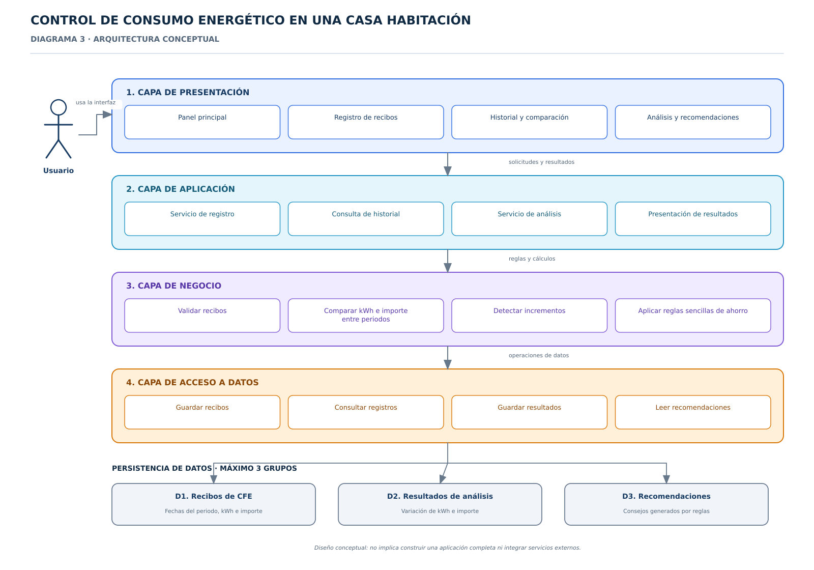
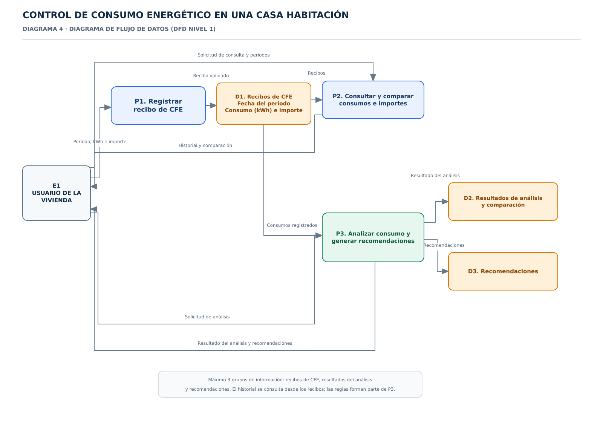

# Diagramas del sistema

Se incorporan los cuatro diagramas revisados del proyecto. Los archivos están en formato **SVG vectorial**, por lo que pueden ampliarse sin perder nitidez y abrirse en herramientas compatibles.

## 1. Diagrama de casos de uso

[Ver archivo SVG](control_consumo_diagrama_1.svg)

## 2. Diagrama de flujo de actividades

[Ver archivo SVG](control_consumo_diagrama_2.svg)

## 3. Diagrama de arquitectura conceptual

[Ver archivo SVG](control_consumo_diagrama_3.svg)

## 4. Diagrama de flujo de datos (DFD nivel 1)

[Ver archivo SVG](control_consumo_diagrama_4.svg)

## Criterios reflejados en los diagramas

- Un solo tipo de usuario: usuario de la vivienda.
- Tres funcionalidades principales: registrar recibos de CFE, consultar y comparar consumos e importes, y analizar incrementos para mostrar recomendaciones.
- Registro manual de periodo facturado, consumo en kWh e importe.
- Sin conexión directa con CFE.
- Si no hay un periodo anterior, el sistema informa que no existe historial suficiente para comparar.
- Máximo tres grupos de información: recibos de CFE, resultados del análisis y recomendaciones.

Los cuatro diagramas están incorporados al repositorio como archivos SVG vectoriales. Las versiones PNG son opcionales. El PowerPoint del prototipo está incorporado por separado en la carpeta `prototipo/`; no forma parte de esta carpeta.